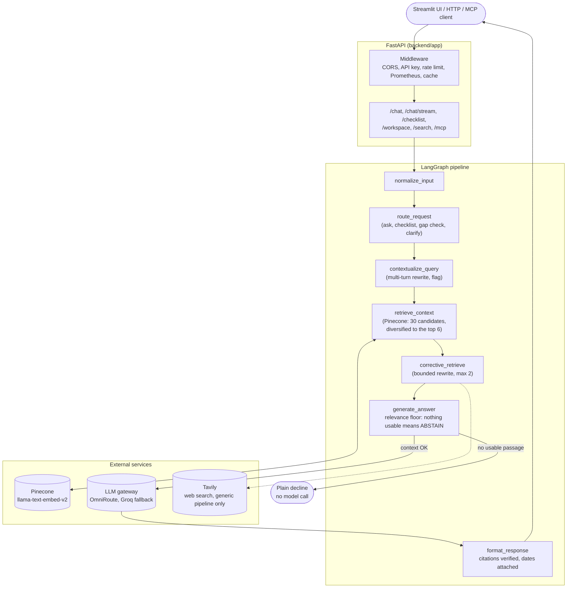

<div align="center">
  <h1>Compliance Workbench</h1>
  <p><b>Which EU and US rules apply to your AI, data or cyber product, and what do they actually say?</b></p>
  <p>Plain answers quoted from the official text of the EU AI Act, GDPR, NIS2, DORA, the Cyber Resilience Act
  and NIST, with the date each rule starts to apply. Built on a measured RAG pipeline that declines instead of
  guessing.</p>

  <p>
    <a href="https://rag-agent-workbench.streamlit.app"><b>Open the app</b></a> ·
    <a href="https://brejbala-rag-agent-workbench-api.hf.space/docs">API docs</a> ·
    <a href="#use-it-from-any-mcp-client">MCP server</a> ·
    <a href="docs/DESIGN.md">Design notes</a>
  </p>

  
  
  
  
  
  
  
  

  <br><br>
  
</div>

> The app is in this repository under its original name, `rag-agent-workbench`. It is information from official
> text, not legal advice.

---

## What it does

| Tool | Use it when you want to know | You get |
|---|---|---|
| **Ask** | What a rule says about something specific | A cited answer, each provision marked *in force* or *from date X*, and a plain decline for rules it does not cover |
| **Checklist** | Which articles bind your product | Articles that apply now, ones coming later, and the one question that would settle the rest. Start from one of 8 ready-made examples |
| **Gap check** | What your own policy covers and misses | A verdict per duty (*covered*, *partial*, *missing*) with quotes from the law and from your policy, both checked word for word |

All three are also tools for Claude and other MCP clients (see [below](#use-it-from-any-mcp-client)).

### Ask


Every answer shows how it was found: the passages retrieved, how each scored against the **relevance floor**,
the answer as it streams, and an evidence drawer per citation with the sentences that cite it and the passage
itself. Questions about rules that are not covered (HIPAA, CCPA, PCI DSS) or licensed standards whose text is not
public (ISO/IEC 27001, 42001, SOC 2) are declined with no model call. If the language model is busy or down, the
turn says so, keeps the sources it found, and offers **Try again**.

### Checklist


Answer only what you know, or pick an example such as *chatbot startup*, *bank scoring credit* or *smart camera
maker*. The checklist covers 112 duty-bearing articles of the AI Act, GDPR, NIS2, DORA and the Cyber Resilience
Act. Each rule cites, word for word, the provision that says whom it binds, and CI checks every quote. No model
decides or words anything in the checklist. Export to Markdown or CSV.

### Gap check

Load a policy (PDF, Word, Markdown or text) and check it against the articles your checklist says bind you, or
against single sections of the NIS2 Implementing Regulation annex. Anything that cannot be verified is marked
for review instead of guessed. You can also load **your own copy of a licensed standard** (ISO/IEC 27001 or 42001)
for that session. Documents stay in your browser session; the server stores, indexes and logs nothing.

### Light and dark


---

## What is covered

| Rulebook | What it is about | Start dates in the timeline |
|---|---|---|
| EU AI Act | Building, selling or using AI in the EU, stricter as the risk rises | 2 Feb 2025 to 2 Aug 2028 |
| GDPR | How organisations may collect and use personal data about people in the EU | 25 May 2018 |
| NIS2 and Implementing Regulation 2024/2690 | Cybersecurity duties for important sectors such as cloud, digital infrastructure, energy and health | 18 Oct 2024, 7 Nov 2024 |
| DORA | Digital resilience for banks, insurers and other financial firms | 17 Jan 2025 |
| Cyber Resilience Act | Security requirements for hardware and software products sold in the EU | 11 Jun 2026 to 11 Dec 2027 |
| NIST SP 800-53, CSF 2.0, AI RMF | Voluntary US frameworks of security and AI risk practices | Voluntary, no dates |

3,946 provisions from 9 official texts, each with a stable reference such as `GDPR Art. 33(1)`. Every start date
comes from a registry ([`applicability.yaml`](backend/app/data/regs/applicability.yaml)) that quotes the sentence
of the law setting it; a test fails if a quote is not in the corpus, so a wrong date cannot be committed.

**Crosswalks.** Each provision lists related requirements in other frameworks, taken only from published mappings
(NIST CSF 2.0 to SP 800-53, SP 800-53 to ISO/IEC 27001, ENISA's NIS2 mapping, and the NIS2 Implementing
Regulation's own headings), with the path each match came through. Mappings show related requirements, not
equivalence. The AI Act, GDPR, DORA and CRA have no published crosswalk yet, and the app says so.

---

## Can you trust it?

Measured on labelled test questions; the Evaluation page shows each run.

| What was measured | Result |
|---|---|
| Right article in the top 6 results, 50 hand-labelled questions | recall 0.847, MRR 0.862 (same budget: dense 0.818, fused 0.779, lexical 0.607) |
| Questions about rules it does not cover, declined with no model call | 13 of 14 |
| Questions it does cover, wrongly declined | 0 of 50 |
| Requests sent to the right tool (ask, checklist, gap check, clarify) | 34 of 36 |
| Gap check: planted gaps wrongly called *covered* | 0 in every run |
| Prompt-injection attacks (10 cases, adversarial suite) | no breaches |

All four compliance golden sets were reviewed by a human on 2026-11-08 (see
[Labelling the golden sets](#labelling-the-golden-sets)); the retrieval and abstention rows above were re-measured
against the reviewed labels and the corrected corpus on 2026-11-08.

---

## How it works



**Design decisions that matter** (details in [`docs/DESIGN.md`](docs/DESIGN.md)):
- **Eval first.** The retrieval harness came before any tuning; labels were set by reading the documents, not by
  running the retriever.
- **Declining is a feature.** A cosine floor derived from the data, plus a scope guard for rules not covered, so
  "I don't know" costs no model call.
- **Dates never come from the model.** They come from the quoted registry above.
- **Reranking measured and switched off.** `bge-reranker-v2-m3` lowered nDCG@3 by 0.057 and added 435 ms.
- **Bounded loops.** Corrective retrieval stops after 2 rewrites; gap checks refuse runs over a 40,000-token budget.
- **Honest streaming and failure.** Real token streaming; cache hits, declines and model outages are labelled as
  such, never faked.

**Models.** All LLM calls go through an OpenAI-compatible gateway. With `OMNIROUTE_API_KEY` set, the app uses the
OmniRoute combos `free-normal` (fallback `free-advanced`); otherwise Groq `openai/gpt-oss-20b` (fallback
`gpt-oss-120b`). One measured run on 2026-11-08 took 12.7 s to write an answer through `free-normal`.

---

## Use it from any MCP client

The API serves an **MCP server** (`mcp` SDK 2.3). It is read-only and stores nothing.

| Tool | What it does |
|---|---|
| `ask(question, as_of?, frameworks?, standards?)` | Cited answer with each provision's status on the date, plus `abstained` and `abstain_reason` |
| `checklist(profile, as_of?, with_text?)` | Which EU-law articles bind the profile: now, coming, or depending on a fact not given |
| `crosswalk(provision, hops?, official_only?)` | Related requirements in other frameworks from published mappings |
| `gap_check(policy_text, articles? \| profile?, as_of?)` | A policy checked duty by duty with verified quotes; reports progress per article |
| `search_knowledge_base(query, namespace?, top_k?)` | Cosine-scored passages, no LLM |

Resources: `rag://guardrails`, `rag://facts`, `rag://obligations`, `rag://crosswalk-sources`, `rag://namespaces`.
Prompts: `grounded_answer`, `compliance_checklist`, `crosswalk_lookup`, `policy_gap_check`.

**Remote (Streamable HTTP):** `POST https://<api-host>/mcp` with header `X-API-Key` (the same key as the REST API).
Responses stream, so `gap_check` progress reaches the client. `python scripts/smoke_mcp.py` checks every tool
against a local API.

**Local (stdio):** add this to your client's `mcpServers` config, replacing `<repo>` with the folder you cloned
into. The server reads its keys from `<repo>/.env`, so start the client from `<repo>` or pass the variables in
`env`.

```json
{
  "mcpServers": {
    "compliance-workbench": {
      "command": "<repo>/.venv/Scripts/python.exe",
      "args": ["-m", "app.mcp_server"],
      "env": { "PYTHONPATH": "<repo>/backend" }
    }
  }
}
```

On macOS or Linux the interpreter is `<repo>/.venv/bin/python`.

---

## Run it locally

**1. API** (Python 3.11)

```bash
python -m venv .venv && . .venv/Scripts/activate      # macOS/Linux: . .venv/bin/activate
pip install --require-hashes -r backend/requirements.txt
cp backend/.env.example .env                          # fill in PINECONE_*, OMNIROUTE_* (or GROQ_API_KEY), API_KEY
uvicorn app.main:app --app-dir backend --port 8000
```

The API checks the Pinecone index at startup and exits on a bad key or host. Open `http://localhost:8000/docs`.

**2. UI** (Python 3.13, separate environment)

```bash
pip install --require-hashes -r requirements.txt
BACKEND_BASE_URL=http://localhost:8000 API_KEY=<same key as the API> streamlit run frontend/app.py
```

High-fidelity PDF and Office conversion uses docling (several GB, with torch). It is not in the hosted UI lock;
install `requirements-docling.txt` instead if you want it locally.

**3. Tests**

```bash
pip install --require-hashes -r requirements-dev.txt
DISABLE_DOTENV=1 python -m pytest tests -q            # 677 tests, no network, never reads .env
PYTHONPATH=frontend python tests/ui/smoke_app.py      # renders every page headlessly
make check-models                                     # live: fails if a configured model or combo stops answering
```

**Secrets.** Keys live only in `.env` (gitignored) locally and in the host's secret store when deployed. The UI
never calls the language model, so it needs only `BACKEND_BASE_URL` and `API_KEY`. The OmniRoute base URL must be
`https`, logs show the host but never the key, and errors never echo upstream messages.

| Where | Variables |
|---|---|
| API | `PINECONE_API_KEY`, `PINECONE_INDEX_NAME`, `PINECONE_HOST`, `OMNIROUTE_API_KEY`, `OMNIROUTE_BASE_URL`, optional `OMNIROUTE_CHAT_MODEL`, `OMNIROUTE_FALLBACK_MODELS`, `GROQ_API_KEY`, `TAVILY_API_KEY`, `API_KEY`, `ALLOWED_ORIGINS`, `RAG_*` flags |
| UI | `BACKEND_BASE_URL`, `API_KEY` |

Full list: [`backend/README.md`](backend/README.md).

---

## Evaluation harnesses

| Harness | What it measures | Run |
|---|---|---|
| Compliance retrieval (`eval/run_regs.py`) | Recall and MRR by retrieval mode on 50 labelled questions | `python eval/run_regs.py --mode diversified --k 6` |
| Abstention (`eval/run_regs.py`) | Out-of-scope declines and wrong declines, no LLM | `python eval/run_regs.py --mode abstain` |
| Routing (`eval/run_router.py`) | Requests sent to the right tool | `python eval/run_router.py` |
| Gap check (`eval/run_gapcheck.py`) | Verdict accuracy, verified-quote rate, false *covered* on planted gaps (live model, about 12k tokens) | `python eval/run_gapcheck.py` |
| Generic retrieval (`eval/run.py`) | Recall@k, MRR, nDCG@k on 30 labelled queries | `make eval` |
| Answers (`eval/run_answers.py`) | Claim recall, faithfulness, citation precision, abstention; judge-vs-human agreement from a calibration CSV | `make eval-answers` |
| Adversarial (`eval/adversarial.py`) | Direct and indirect injection, delimiter forgery, exfiltration | `make eval-adversarial` |

Publish the latest runs to the UI with `python eval/publish_results.py`.

### Labelling the golden sets

Each golden file starts with a `_meta` line whose `label_status` records who reviewed it and what changed. All four
were reviewed by a human on 2026-11-08: the router and gap-check sets were confirmed as they were; 13 retrieval
questions and 5 checklist profiles were corrected, and the checklist gained four facts so the rules could follow
(right to an explanation, transfers under safeguards, open-source models, own-brand importers), with DNS providers
and TLD registries now separate.

| File | One line is | Check that |
|---|---|---|
| [`eval/regs_golden.jsonl`](eval/regs_golden.jsonl) | a question and the provision ids that answer it | each listed provision really answers the question, and none is missing |
| [`eval/regs_profiles.jsonl`](eval/regs_profiles.jsonl) | a company profile and the articles that `binds`, `depends` on a missing fact, or do `not` bind | each article is in the right bucket for that profile |
| [`eval/regs_router.jsonl`](eval/regs_router.jsonl) | a request and the tool it should go to | the expected tool is right |
| [`eval/gap_golden.jsonl`](eval/gap_golden.jsonl) | a policy (in `eval/gap_golden/`) and the expected verdict per duty | each verdict matches what the policy says |

To review again: fix a line in place, then update `label_status` in the `_meta` line
(`reviewed-<who>-<date>: <what changed>`).
Re-run the matching harness from the table above and `python eval/publish_results.py`, so the UI shows numbers
measured against the reviewed labels.

---

## Project structure

```text
rag-agent-workbench/
├─ backend/app/
│  ├─ routers/          # chat, checklist, workspace (gap check), search, ingest, health, metrics
│  ├─ services/         # chat/ (LangGraph graph + streaming), llm/ (gateway), regs/ (dates, rules, crosswalks, gap check)
│  ├─ data/regs/        # corpus, applicability.yaml, facts.yaml, obligations.yaml, crosswalks
│  ├─ mcp_server.py     # MCP tools, resources and prompts
│  └─ core/             # config, auth, cache, rate limit, metrics
├─ frontend/
│  ├─ app.py            # shell: navigation, API status, theme switch
│  ├─ views/            # home, ask, checklist, gapcheck, evaluation
│  ├─ services/         # API client, presenters, Home HTML builders, eval snapshot shaping
│  └─ static/theme.css  # the visual layer
├─ eval/                # harnesses, golden sets, results/ snapshots the UI reads
├─ tests/               # unit, integration and UI smoke tests
├─ scripts/             # model gate, MCP smoke test, benchmarks
└─ docs/                # DESIGN, CONTEXT, specs and plans, media/ (README GIFs)
```

---

## Hosting and limits

| | |
|---|---|
| UI | Streamlit Community Cloud: https://rag-agent-workbench.streamlit.app |
| API | Hugging Face Space (Docker, CPU Basic): https://brejbala-rag-agent-workbench-api.hf.space |

- The Space sleeps after 48 hours idle; the first request then waits for a restart. The UI shows a wake-up timer.
- The Streamlit app sleeps after 12 hours without traffic.
- Pinecone Starter: one region, 2 GB, 1M read units a month. Tavily free: 1,000 credits a month.
- The free OmniRoute combos can be slower than a paid model and may hit provider limits; the Ask page then shows
  the sources it found and a retry button.
- `make check-models` (also run weekly in CI) fails when a configured model or combo stops answering.

### Landing site (GitHub Pages)

The Streamlit app is a single-page app, so search engines see almost no text on it. `site/` holds a small
static site that they can read: a home page, one page per rulebook, "When the rules start" and an FAQ, each
linking into the app.

```bash
python site/build.py          # writes site/dist/ (stdlib only); open site/dist/index.html or serve it:
python -m http.server -d site/dist 8000
```

Dates come only from `eval/results/timeline.json` and quotes only from `backend/app/data/regs/regs-v1.jsonl`;
the build stops on a quote that is not in its provision, and `tests/test_site.py` fails on any date or quote
that is not in those files. `.github/workflows/pages.yml` builds the site on every push to `main` that touches
it, and deploys only once Pages is switched on.

Steps that need the repository owner (none is done yet):

| Step | Where | Cost |
|---|---|---|
| 1. Turn on Pages: Source = "GitHub Actions" | Settings > Pages | Free for public repositories |
| 2. Add the repository variable `PAGES_ENABLED` = `true`, then run "Landing site" once | Settings > Secrets and variables > Actions > Variables; Actions tab | Free |
| 3. Check https://brej-29.github.io/rag-agent-workbench/ loads | Browser | Free |
| 4. Add a URL-prefix property for that address in Google Search Console, choose the HTML tag method, put the tag's `content` value in a repository variable `GOOGLE_SITE_VERIFICATION`, rerun "Landing site", press Verify, then submit `sitemap.xml` | search.google.com/search-console | Free |
| 5. Optional: a custom domain. Set the `SITE_URL` repository variable to it, add it under Settings > Pages, and point DNS at GitHub | Domain registrar | Domain costs money (price not checked) |

---

## Documentation

| Document | What it covers |
|---|---|
| [`docs/DESIGN.md`](docs/DESIGN.md) | Design decisions, trade-offs and limits |
| [`docs/superpowers/specs/2026-10-20-compliance-copilot-design.md`](docs/superpowers/specs/2026-10-20-compliance-copilot-design.md) | Compliance features: design and measured results |
| [`docs/superpowers/specs/2026-11-08-ui-redesign.md`](docs/superpowers/specs/2026-11-08-ui-redesign.md) | The UI redesign |
| [`docs/CONTEXT.md`](docs/CONTEXT.md) | Decision log and runbook |
| [`backend/README.md`](backend/README.md) | API catalogue, environment variables, deployment |
| [`CHANGELOG.md`](CHANGELOG.md) | What changed, when |

## License

MIT, see [`LICENSE`](LICENSE).
